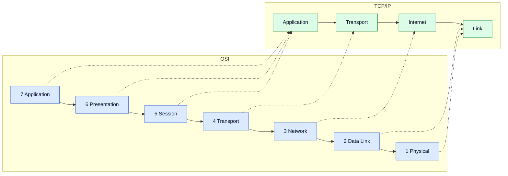
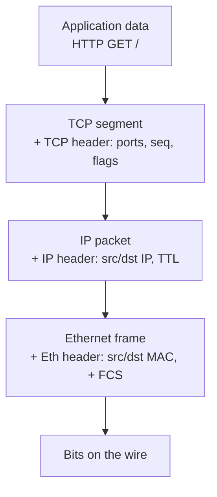
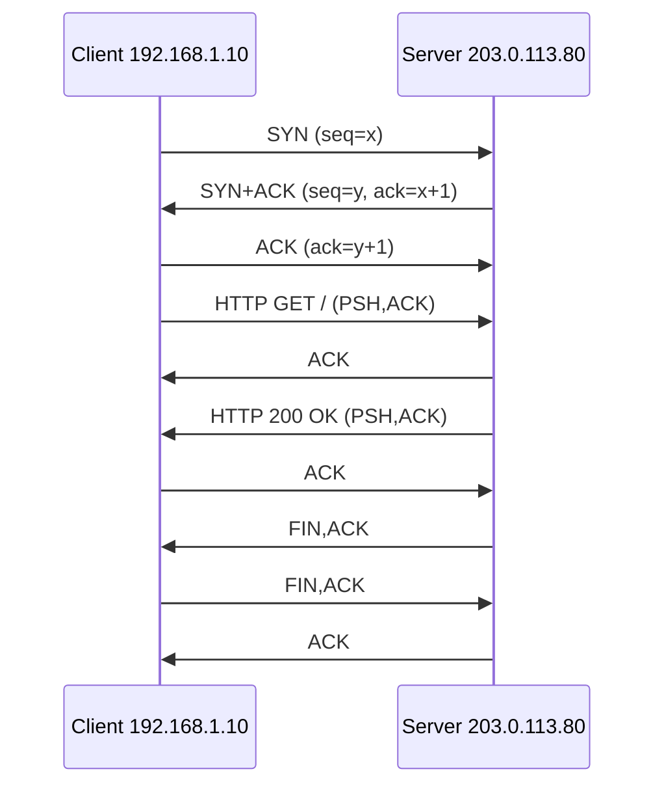
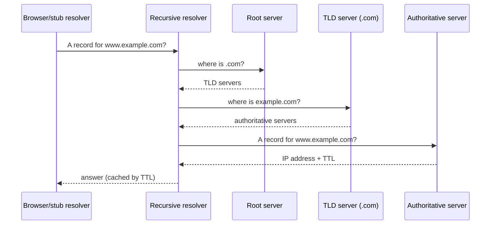

# Diagrams (Mermaid - render automatically on GitHub)

## 1. OSI vs TCP/IP mapping

## 2. Encapsulation

## 3. TCP three-way handshake and HTTP exchange (matches sample capture)

## 4. DNS resolution

